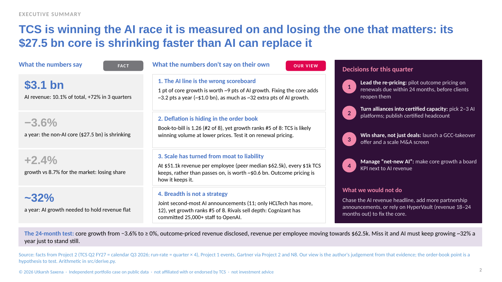

# Getting ahead of AI deflation: a growth agenda for TCS

**AI-assisted consulting report: converting project findings into an executive presentation with strategic recommendations (PowerPoint).**

**Deck:** [PowerPoint](outputs/TCS_AI_Deflation_Strategy.pptx) · [PDF](outputs/TCS_AI_Deflation_Strategy.pdf) · **Web view:** https://lokpriye96.github.io/ai-consulting-report-genai-services/

Project 3 of 3 in a linked series:

| # | Project | Question | Links |
|---|---|---|---|
| 1 | AI-Powered Competitive Intelligence Tracker | What are 8 IT services leaders *announcing* in GenAI? | [Repo](https://github.com/lokpriye96/ai-ci-tracker) · [Dashboard](https://lokpriye96.github.io/ai-ci-tracker/) |
| 2 | GenAI Services Market Analytics & Competitive Dashboard | Is AI showing up as *revenue*, and is it net-new? | [Repo](https://github.com/lokpriye96/genai-services-market-analytics) · [Dashboard](https://lokpriye96.github.io/genai-services-market-analytics/) |
| 3 | **AI-Assisted Consulting Report** (this repo) | So what should a leader *do* about it? | 13-slide deck (one-page executive summary + 11 slides + appendix) |



**Slide 2 is a one-page executive summary.** It separates **facts** (from the data) from **our view** (judgement the data does not state on its own):

1. **The AI line is the wrong scoreboard:** 1 pt of core growth is worth ~9 pts of AI growth.
2. **Deflation is hiding in the order book:** book-to-bill ranks #2 of 8 but growth ranks #5, so TCS is likely winning volume at lower prices (a hypothesis to test on renewal pricing).
3. **Scale has turned from moat to liability:** at TCS's headcount, every $1k of revenue per employee it keeps rather than passes on is worth ~$0.6 bn.
4. **Breadth is not a strategy:** joint second-most AI announcements (11; only HCLTech has more, with 12), yet growth ranks #5 of 8.

---

## The business question

> **How should TCS respond to AI deflation over the next 24–36 months?**

- **Client (hypothetical):** TCS CEO and strategy office.
- **Why TCS:** company-reported AI revenue (evidence grade A) with four quarters of history, and the clearest tension in the data: strong bookings, slow growth.
- **Framings considered and rejected:**
  - Infosys: fastest core decline, but its “AI-first” definition is the broadest, so the finding is the least robust.
  - A GCC / enterprise buyer capturing AI savings: a strong question, but Projects 1 and 2 hold vendor-side data, not contract data.

**Objectives:** test whether AI is net-additive for TCS; size the gap AI has to close; prioritise 3–4 moves with KPIs and risks; sequence them into a roadmap.

## Storyline (situation → complication → resolution)

| | Finding | Evidence |
|---|---|---|
| **Situation** | AI is 10.1% of TCS revenue: a $3.1 bn run-rate, up 72% in three quarters. Book-to-bill is 1.26. | Project 2; TCS releases |
| **Complication 1** | TCS's non-AI core is shrinking 3.6% a year. TCS grew 2.4% in USD vs 8.7% for the IT services market. | Project 2 `sql/03`, `sql/01`; Gartner |
| **Complication 2** | Clients want the same output for 25–30% less and reopen contracts within 24 months. Announcement counts correlate −0.66 with growth. | N1, N2, N3; Projects 1 × 2 |
| **So what** | At today's core decline, AI must grow ~32% a year just to keep revenue flat. 1 pt of core growth adds ~0.9 pt of total growth; 10 pts of AI growth add ~1.0 pt. | `src/derive.py` |

## Recommendations (in priority order)

| # | Move | Rationale | KPIs to track | Main risk |
|---|---|---|---|---|
| 1 | **Lead the re-pricing:** move the application and infrastructure annuity book to outcome pricing before clients force it | Core −3.6%/yr is the biggest drag; ~80% of TCS's finance, HR and BPO contracts already run on outcomes (N1) | Core growth −3.6%/yr → ≥ 0% in 24 months; share of outcome-priced revenue; renewal price change; EBIT margin vs 25%+ target | TCS takes delivery risk |
| 2 | **Turn alliances into certified capacity:** 2–3 platforms, named certified teams | Announcements do not predict growth (ρ = −0.66); widest bench, slowest of the four largest firms | Certified practitioners per platform; AI bookings and win rate per alliance | Model leadership shifts |
| 3 | **Win share, not just deals:** AI-led operations, GCC takeovers, scale M&A | Book-to-bill 1.26 but growth 2.4% vs market 8.7%; Capgemini bought scale (WNS, $3.3 bn) | Share of Gartner IT services (1.64% today); TCV-to-growth conversion; GCC takeovers | Integration, margin dilution |
| 4 | **Manage “net-new AI”:** run and report on core growth, AI bookings, revenue per employee | AI share does not predict growth (ρ = −0.05); revenue per employee $51.1k vs peer median $62.5k | Core growth disclosed quarterly; AI share of bookings; revenue per employee | Disclosure exposes the decline |

KPI targets are proposals, not forecasts. The 36-month roadmap and decision gates are on slide 11.

## Method

```
Project 1 + Project 2 outputs ──copy──▶ data/inputs/ ──src/derive.py──▶ data/derived.json ──src/build_deck.js──▶ outputs/*.pptx ──LibreOffice──▶ *.pdf
New public sources (N1–N8) ─────────────▶ data/new_sources.csv ─────────────────────┘
```

- **No hand-typed numbers in the deck.** `src/build_deck.js` reads only `data/derived.json` and the cited new-source facts. `tests/test_derived.py` pins the headline numbers.
- **Inputs:** Project 2 SQL results, analysis files and TCS AI disclosures; Project 1's 72-event database (70 verified). Basis: latest quarter = calendar Q3 2026 (TCS Q2 FY27); run-rate = quarter × 4; USD.
- **Derived arithmetic:** TCS core = revenue − AI. One-year growth = (AI × AI growth + core × core growth) ÷ total.
- **New sources (N1–N8),** all public, listed with URLs in [`data/new_sources.csv`](data/new_sources.csv): Reuters (via Outsource Accelerator) on outcome pricing, HFS Research on renegotiation, Everest Group (via Let's Data Science/Moneycontrol) on deflation, JM Financial (via Business Today) and Business Standard on TCS management views, Tata Group, Inc42 and People Matters on HyperVault.
- **Native PowerPoint charts and tables,** so every chart can be edited in PowerPoint.
- **Design:** a purple-led palette with red reserved for critical points, Arial headings and Calibri body text.

**Rebuild**

```bash
pip install pytest        # Python 3.11+, standard library otherwise
npm install pptxgenjs     # Node 18+
./build.sh                # derive → deck → PDF (needs LibreOffice) → tests
```

## Limitations (read before quoting a number)

- **AI revenue definitions differ by firm.** TCS reports “AI services” revenue; its CEO has said AI-assisted delivery is not automatically AI revenue (N5).
- **Core shrinkage is an upper bound:** part of AI growth may be existing work relabelled as AI.
- **Thin time series:** TCS's core growth rests on two points three quarters apart, annualised.
- **Run-rate = quarter × 4,** which ignores seasonality.
- **The sensitivity table is one-year arithmetic, not a forecast.** KPI targets and impact ratings are the author's proposals.
- **Small sample:** correlations use 8 firms. They are directional, not statistical proof.
- **Secondary sources:** N1–N5, N7 and N8 are press or analyst reports of company figures; each is marked in the source list.
- **Out of scope:** the HyperVault AI data-centre business (a separate capital case) and the share price.
- **Hypothetical client.** No TCS input was used; this is an outside-in view on public data.

## How this was built

- **AI assistance, disclosed.** I built this project with Claude (Anthropic) as an AI assistant, as I did for Projects 1 and 2.
- **My role:**
  - choosing the client, the business question and the framing;
  - setting the standards: public data only, every number traceable to Project 1, Project 2 or a cited source, limitations stated;
  - reviewing the storyline, recommendations, KPIs and risks;
  - owning every decision, the published result and the commit history.
- **Claude's role:** drafting the storyline, finding the new sources, writing the derivation script and deck generator, and drafting this README, under my direction.
- **Controls, so the numbers do not depend on trusting the AI:**
  1. The deck reads numbers from `data/derived.json` only; nothing is typed into slides by hand.
  2. `derive.py` recomputes from Project 1 and 2 files copied unchanged into `data/inputs/`.
  3. `tests/test_derived.py` pins the headline figures.
  4. Every new fact carries a source ID (N1–N8) on the slide and a URL in `data/new_sources.csv`.
  5. Each slide was checked visually after rendering.
- **Independence.** Independent portfolio project on public data. Not affiliated with or endorsed by TCS or any company named. Not investment advice.

## Repository layout

```
data/inputs/         Project 1 and 2 files used (unchanged copies)
data/new_sources.csv new public sources N1–N8
data/derived.json    every number in the deck (built)
src/                 derive.py, build_deck.js
outputs/             TCS_AI_Deflation_Strategy.pptx / .pdf
docs/                GitHub Pages web view + slide images
tests/               headline-number tests
```

## Licence

- **Report, deck, web page and write-up:** © 2026 Utkarsh Saxena, licensed [CC BY-NC-ND 4.0](LICENSE-CONTENT.md). You may share them unchanged with credit, but not change them or use them commercially without permission.
- **Code** (`src/`, `tests/`, `build.sh`): [MIT](LICENSE-CODE).

Author: Utkarsh Saxena · [LinkedIn](https://www.linkedin.com/in/utkarsh-lokpriye-)
